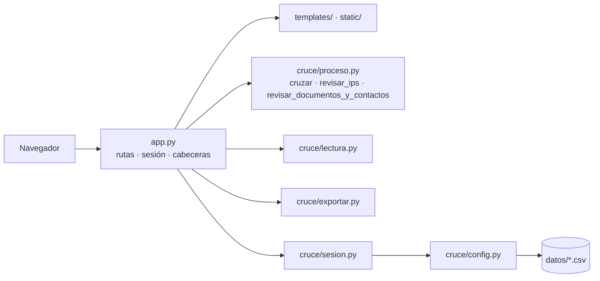

# Cruce de afiliados — Coosalud EPS

Aplicación web (Python · Flask · pandas) que automatiza el **cruce mensual de afiliados**: cruce contra BDUA → IPS por municipio y régimen → documentos y contactos → archivos para descargar.
Proyecto académico EAFIT (Sistemas de Información, 2026-2) con Coosalud EPS. Equipo: Santiago José Puello Berrocal · Juan Diego Muñoz Buitrago · Sebastián Vásquez Saldarriaga.

> 🔒 **Este repositorio no contiene datos reales y nunca debe contenerlos** (datos de salud, Ley 1581 de 2012). Para probar se usan solo los archivos de `datos_prueba_ficticios/`.

## Accesos directos
| Quiero… | Ir a |
|---|---|
| Ejecutarlo ya | [1. Inicio rápido](#1-inicio-rápido) |
| Saber cómo se usa | [2. Uso paso a paso](#2-uso-paso-a-paso) |
| Ver qué columnas piden y qué archivos entrega | [3. Archivos de entrada y salida](#3-archivos-de-entrada-y-salida) |
| Entender las reglas del negocio | [4. Reglas de negocio](#4-reglas-de-negocio) |
| Entender cómo está construido | [5. Arquitectura](#5-arquitectura) |
| Conocer las reglas de buena programación | [6. Buenas prácticas](#6-buenas-prácticas-de-programación) |
| Revisar seguridad y privacidad | [7. Seguridad y privacidad](#7-seguridad-y-privacidad) |
| Correr las pruebas | [8. Pruebas](#8-pruebas) |
| Ponerlo en un servidor | [9. Servidor de la empresa](#9-servidor-de-la-empresa) |
| Ver qué está hecho y qué falta | [10. Estado y backlog](#10-estado-del-proyecto-y-backlog) |
| Subirlo a GitHub (privado) | [11. Subir a GitHub](#11-subir-a-github-de-forma-privada) |
| Resolver un error | [12. Problemas frecuentes](#12-problemas-frecuentes) |

---

## 1. Inicio rápido
Requisitos: **Python 3.11 o superior** (probado con 3.13 y 3.14).

**Opción A — un solo comando**
- Mac / Linux: `./iniciar.sh` (si no deja: `chmod +x iniciar.sh`)
- Windows: doble clic en `iniciar.bat`

Crean el entorno `.venv`, instalan lo necesario y abren el servidor en <http://localhost:8080>.

**Opción B — manual**
```bash
python3 -m venv .venv
source .venv/bin/activate          # Windows: .venv\Scripts\activate
pip install -r requirements.txt
python app.py                      # http://localhost:8080
```
> ⚠️ Ejecute siempre con el entorno activo (`python app.py` después de activarlo, o `.venv/bin/python app.py`). Con el Python del sistema aparece `ModuleNotFoundError: No module named 'pandas'`.

Para probar: en el paso 1 suba los cinco archivos de `datos_prueba_ficticios/` (`BD_SINERGIA_DEMO.xlsx` = base nacional; los otros cuatro = tablas BDUA).

---

## 2. Uso paso a paso
| Paso | Qué hace | Botón principal |
|---|---|---|
| **1. Cargar archivos** | Sube la base nacional y 1–4 tablas BDUA (Excel o CSV); valida columnas y dice cuál falta; se marcan los estados vigentes y los departamentos (`05,17,27`) | Subir archivos → Continuar al cruce |
| **2. Cruce con BDUA** | Depura repetidos; muestra cuántos cruzan, cuáles **no** cruzan y qué no vigentes sí aparecen en BDUA. Opción: cruzar solo por número | Ejecutar cruce |
| **3. IPS por municipio** | Compara la IPS de cada afiliado con la regla de su municipio y régimen. Las reglas se agregan, editan, quitan, importan/exportan en CSV | Revisar IPS |
| **4. Documentos y contactos** | Revisa edad vs. tipo de documento (a una fecha de referencia) y separa a quienes tienen celular/correo válidos | Revisar documentos y contactos |
| **5. Resumen y descargas** | 9 archivos en Excel o CSV, generados al pulsar el botón | Descargar |

Siempre disponibles: **Ocultar/Mostrar documentos** (por defecto salen enmascarados) y **Limpiar todos los datos** (púlselo al terminar). Los pasos van en orden y, si cambia algo de un paso, **se borran los resultados de los siguientes** a propósito.

---

## 3. Archivos de entrada y salida
**Base nacional** — obligatorias: `TIPO_IDENTIFICACION`, `NUMERO_IDENTIFICACION`, `ESTADO`, `DEPARTAMENTO`, `PORTABILIDAD`, `DEPARTAMENTO_PORTABILIDAD`, `CIUDAD_PORTABILIDAD`, `REGIMEN`, `IPS_ASIGNADA`, `FECHA_NACIMIENTO`. Opcionales: `CELULAR`, `CORREO_ELECTRONICO` (sin ellas se omite la parte de contactos), `CIUDAD`.
**Tablas BDUA** (`AFI_BDUA`, `AFI_EPSS42`, `AFI_ESSC24`, `AFI_EPS042`) — obligatorias: `TIPO_IDENTIFICACION`, `NUMERO_IDENTIFICACION`, `ESTADO`. Las columnas extra se ignoran. Hoy se lee **solo la primera hoja** de cada Excel.

**Salidas (paso 5):** `base_final_depurada` · `vigentes_que_no_cruzan_con_BDUA` · `no_vigentes_encontrados_en_BDUA` · `IPS_por_corregir` · `municipios_sin_regla_de_IPS` · `documentos_por_revisar` · `contactos_para_envio` · `sin_contacto_valido` · `resumen_del_ciclo` (solo conteos, sin datos personales). Nombre: `<archivo>_AAAA-MM-DD.xlsx|csv`.

---

## 4. Reglas de negocio
Las marcadas **(por confirmar)** deben validarse con Sandra / el Dr. Edwin; **(pendiente)** = aún no implementado.

1. **Vigentes:** estado dentro de los marcados en pantalla. Preseleccionados: `VIGENTE`, `VIGENTE CS`, `COBERTURA INICIAL`, `ACTIVO EN PROCESO DE TRASLADO DE SALIDA`, `VIGENTE - PENDIENTE INICIO COBERTURA RC`, `AC` **(por confirmar)**.
2. **Alcance:** vigentes cuyo `DEPARTAMENTO` está en la lista, o con `PORTABILIDAD = SI` hacia un departamento de la lista.
3. **Base depurada:** una fila por persona (`TIPO|NÚMERO`); si está repetida se prefiere la de portabilidad hacia la zona.
4. **Cruce:** llave `TIPO|NÚMERO` (o solo número) contra las 4 tablas BDUA. *(pendiente: llave `AFL_ID_BDUA`)*.
5. **IPS:** regla = `DEPARTAMENTO + MUNICIPIO + RÉGIMEN` (o `*`) → IPS principal + otras permitidas, usando el **departamento/municipio de portabilidad**. Correcta si la IPS es una permitida; si no, se propone la principal; sin regla → lista con la IPS más frecuente y botón "Crear regla". Aplicar la propuesta trabaja en una copia (`IPS_ORIGINAL`). *(pendiente: portabilidad según el procedimiento SQL, IPS por residencia)*.
6. **Documentos (reglas iniciales, por confirmar):** CC 18–120 años · TI 7–17 · RC 0–6 · CN máximo 90 días de vida (los CN vencidos pueden salir de la base final). La edad se calcula a la fecha de referencia elegida.
7. **Contactos:** celular válido = 10 dígitos que empiezan por 3 (se ignora el prefijo 57); correo válido = forma `algo@dominio.ext`. Categorías: ambos · solo celular · solo correo · ninguno.
8. **Pendientes de la reunión con Sandra:** sincronización (añadir activos / eliminar inactivos), identificación de personas especiales CIDH (`TIPO_POBLACION = 9-CIDH`) antes de documentos y contactos, y exportables por municipio y por `CODIGOIPS`.

Las reglas de IPS y de documento por defecto están en `datos/reglas_ips.csv` (66 reglas) y `datos/reglas_documento.csv`: son **datos editables, no código**.

---

## 5. Arquitectura

| Archivo | Responsabilidad | No debe |
|---|---|---|
| `app.py` | Rutas Flask, sesión, cabeceras de seguridad, descargas | Contener reglas de negocio |
| `cruce/proceso.py` | Las 3 reglas de negocio como **funciones puras** | Importar Flask ni leer archivos |
| `cruce/lectura.py` | Excel/CSV en memoria → tabla de texto con encabezados en MAYÚSCULAS | Decidir qué columnas importan |
| `cruce/exportar.py` | Tabla → bytes `.xlsx`/`.csv` en memoria | Escribir a disco |
| `cruce/sesion.py` | Estado por persona en memoria, vence a los 30 min, borra en cascada | Conocer HTTP |
| `cruce/config.py` | Constantes y carga de reglas por defecto | Tener reglas incrustadas |
| `servidor.py` | Arranque con waitress y variables de entorno | Tener rutas |
| `templates/` `static/` | Pantallas en HTML + CSS, **sin JavaScript** | Calcular nada |
| `tests/` | 18 pruebas con datos ficticios | Usar datos reales |

**Decisiones clave y por qué**
- *Flask + HTML en el servidor, sin JS:* lo usa una analista desde el navegador sin instalar nada; menos piezas y más fácil de asegurar con un equipo de tres.
- *Capas con dependencias en un solo sentido* (`app.py → cruce/`, nunca al revés): la lógica se prueba sin servidor y se puede cambiar la fuente de datos (p. ej. SQL Server) tocando solo `lectura.py`.
- *Sin persistencia:* todo vive en memoria; menos copias de datos de salud = menos riesgo.
- *Reglas como datos (CSV + pantalla):* los contratos cambian casi cada mes.
- *Un solo proceso con varios hilos:* el estado de cada persona vive en la memoria del proceso (no usar varios *workers*).
- *Columnas internas con prefijo `_` (`_k`, `_tabla`, `_estado`):* un error real (`KeyError: 'ESTADO_BDUA'`) mostró que la base nacional puede traer columnas con el mismo nombre que las de salida.

**Rutas:** `GET /paso/<n>` · `POST /paso/1/subir|quitar|continuar` · `POST /paso/2/ejecutar` · `POST /paso/3/accion` · `GET /reglas_ips.csv` · `POST /paso/4/accion` · `GET /descargar?clave=…&formato=xlsx|csv` · `POST /mascara` · `POST /limpiar`. Cada acción es un `POST` que redirige a un `GET` (así recargar no repite la acción).

**Cómo crece sin romper las capas:** llave `AFL_ID_BDUA` = parámetro nuevo en `cruzar()`; portabilidad/sincronización/CIDH = funciones puras nuevas en `cruce/` + un paso en `app.py`; SQL Server = módulo nuevo que devuelva los mismos `DataFrame` que `lectura.py`.

---

## 6. Buenas prácticas de programación
**Principios:** KISS (lo más simple que cumpla) · YAGNI (nada que ninguna historia pida) · DRY (cada regla en un solo lugar) · separación de responsabilidades · alta cohesión y bajo acoplamiento · fallar pronto y con un mensaje claro · privacidad por diseño.

**SOLID aplicado:** *S* un motivo de cambio por módulo (⚠️ `app.py` aún mezcla rutas con armado de tablas) · *O* agregar una regla de IPS no modifica código · *L* cualquier fuente que entregue un `DataFrame` con las columnas esperadas sirve · *I* las funciones piden solo lo que usan (`revisar_ips(base, reglas, aplicar)`) · *D* la lógica no depende de Flask: recibe datos y reglas por parámetro.

**Reglas para escribir código aquí**
1. **Lógica en `cruce/`, no en `app.py`.** Una ruta se lee en ~10 líneas: validar → llamar → guardar en sesión → redirigir. `cruce/` no importa Flask.
2. **Funciones puras:** todo entra por parámetros (incluida la fecha de referencia); no se lee la hora del sistema, ni archivos, ni globales.
3. **No mutar las entradas:** `base.copy()` antes de agregar columnas; devolver resultados nuevos (`dataclass`).
4. **Nombres:** `snake_case`; dominio en español (`cruzar`, `reglas_ips`), términos técnicos universales en inglés; nombres que dicen *qué es* (`por_corregir`, no `df2`); constantes con nombre, sin números mágicos.
5. **Tipos y docstrings** en funciones públicas; el comentario explica el **porqué**, no el qué.
6. **Datos externos no confiables:** leer todo como texto (no se pierden ceros: `05`, `001`), normalizar al entrar, validar columnas y decir cuál falta, tolerar duplicados y vacíos, usar columnas internas con prefijo `_`.
7. **pandas:** vectorizar (nada de `iterrows` sobre 400 000 filas), `.loc` para asignar, `reset_index(drop=True)` al devolver.
8. **Errores:** excepciones específicas; `except Exception` solo en el borde (subida de archivos) y convertido en mensaje comprensible; **mensajes y registros sin datos personales**.
9. **Configuración y secretos:** variables de entorno (`CRUCE_HOST`, `CRUCE_PUERTO`, `CRUCE_CLAVE`, `CRUCE_USUARIO`); valores por defecto seguros; nunca claves en el código.
10. **Seguridad:** Jinja con autoescape (no `|safe` con datos), nada de `eval`/`pickle`, validar entradas del usuario, claves con `secrets.compare_digest`.
11. **Dependencias:** pocas y justificadas; rangos con tope mayor (`flask>=3.0,<4`).
12. **Rendimiento:** primero correcto y probado, luego medir. Con ~400 000 filas el cálculo tarda segundos; lo lento es leer/escribir Excel → usar CSV.
13. **Cada error real → una prueba de regresión** antes de corregirlo.

**Antipatrones a evitar:** datos reales en el repo · "función Dios" que lee, calcula y muestra · variables globales mutables · reglas incrustadas en el código · `except: pass` · optimizar sin medir · pull requests gigantes.

**Lista para revisar un pull request:** ¿cumple todos los criterios de aceptación? · ¿hay pruebas que fallarían si se rompe? · ¿casos límite (vacíos, duplicados, ceros, fechas inválidas)? · ¿la lógica nueva está en `cruce/`? · ¿sin datos reales ni secretos? · ¿no escribe archivos ni registra datos personales? · ¿pruebas en verde? · ¿lo revisó otra persona?

**Git:** una historia = una rama (`HU-09-documentos-edad`) = un pull request pequeño revisado por otra persona. Commits: `HU-09: validar edad contra el tipo de documento` (prefijos sin historia: `fix:`, `docs:`, `test:`, `refactor:`, `chore:`).

**Deuda técnica conocida:** `app.py` (≈370 líneas) mezcla rutas con descargas y tablas; `proceso.py` se dividirá en módulos al agregar portabilidad y CIDH; solo se lee la primera hoja de un Excel; estilo compacto (varias instrucciones por línea); sin token CSRF (se usa `SameSite=Strict`); sin límites de tamaño ni de sesiones simultáneas; `int(accion[7:])` sin validar; con un proxy HTTPS la cookie necesitará `ProxyFix` para marcarse `Secure`.

---

## 7. Seguridad y privacidad
- **Sin persistencia:** los archivos subidos se leen en memoria (no se crean temporales), el estado vive en la sesión de cada persona y se borra con *Limpiar*, a los **30 minutos sin uso** o al apagar. Lo descargado se genera al momento.
- **Cabeceras:** CSP `default-src 'none'` (sin scripts ni recursos externos), `Cache-Control: no-store`, `nosniff`, `Referrer-Policy: no-referrer`. Cookie `sid` `HttpOnly` + `SameSite=Strict`.
- **Acceso:** escucha solo en `127.0.0.1` por defecto; si se abre a la red, **definir `CRUCE_CLAVE`**. Sin HTTPS los datos viajan sin cifrar por la red interna → TI debe poner HTTPS delante.
- **Documentos enmascarados** en pantalla (`12••••••89`).
- **Repositorio:** `.gitignore` bloquea `.xlsx`, `.csv`, `.sql`, `.zip`, `.env`, `.pem`; solo se permiten `datos/*.csv` (reglas) y `datos_prueba_ficticios/*.xlsx` (inventados: documentos que empiezan por 9000/8000 y apellido `FICTICIO`). Antes de cada push: `git status` y revisar qué se sube.
- Si se sube algo sensible por error: avisar de inmediato, no apilar commits, limpiar el historial (`git filter-repo`), rotar secretos e informar a Coosalud.
- **Pendiente:** usuarios con hash y roles, HTTPS, límites de memoria, registro de uso sin datos personales.

---

## 8. Pruebas
```bash
python -m pytest              # 18 pruebas (~10 s)
python -m pytest -k ips       # solo las de IPS
```
`tests/test_cruce.py` prueba la **lógica** directamente (cruce, IPS, documentos, celulares, vencimiento de sesiones, regresión de columnas) y `tests/test_web.py` recorre los **5 pasos** con el cliente de Flask (pasos bloqueados en orden, máscara, cabeceras, que **no queden archivos temporales**, 4 descargas × 2 formatos, reglas, clave, archivo dañado, CSV con columnas faltantes). Las cifras esperadas (654 filas, 522 en la base, 492 cruzan, 350 IPS correctas, 65 por corregir, 517 en la base final…) salen de un cálculo independiente sobre los datos ficticios.

---

## 9. Servidor de la empresa
Objetivo: la analista abre `https://servidor-interno:puerto` desde su equipo, sin instalar nada. Propuesta (a validar con TI):
1. Servidor interno con Python 3.11+, usuario de servicio sin privilegios y memoria suficiente (**medir** con archivos del tamaño real).
2. Variables: `CRUCE_HOST=127.0.0.1` (la app solo escucha en local) y `CRUCE_CLAVE=<clave>`; **un solo proceso** (`python app.py`) registrado como servicio (systemd en Linux; NSSM o Programador de tareas en Windows) con arranque automático.
3. Un **proxy inverso con HTTPS** (certificado interno) delante, reenviando a `127.0.0.1:8080`.
4. Verificar: acceso desde otro equipo, 401 sin clave, sin respuesta fuera de la red interna, y **ningún archivo de datos** en el servidor tras varios ciclos.

| Variable | Por defecto | Uso |
|---|---|---|
| `CRUCE_HOST` | `127.0.0.1` | `0.0.0.0` abre a toda la red (solo con clave) |
| `CRUCE_PUERTO` | `8080` | Puerto |
| `CRUCE_USUARIO` / `CRUCE_CLAVE` | `cruce` / vacío | Con clave, la app pide usuario y clave |

---

## 10. Estado del proyecto y backlog
**Resumen (corte 24-oct-2026):** 29 historias y 95 tareas · 113 puntos · **Sprint 1 cerrado (28 puntos, 8 de 8 historias, 24 de 24 criterios cumplidos)** · HU-09, HU-10 y HU-11 ya tienen una primera versión en el código y quedan *en revisión* (faltan pruebas de casos límite y validar con Sandra).
Responsables propuestos: **DAT** Sebastián (datos y reglas) · **WEB** Santiago (app y pantallas) · **OPS** Juan Diego (calidad, servidor, documentación). Scrum Master rotativo: S1 Santiago, S2 Juan Diego, S3 Sebastián, S4 Santiago. Dueño del producto: Dr. Edwin (por confirmar).
**Definición de terminado:** criterios cumplidos con prueba · pull request aprobado por otra persona · pruebas en verde · sin datos reales · sin archivos de datos en el servidor.

**Sprint 1 - MVP funcional: cruce e IPS de punta a punta (local, datos ficticios)** — 28 puntos

| ID | Historia | Pts | Estado |
|---|---|---|---|
| HU-01 | Subir la base nacional y las tablas BDUA del mes en Excel o CSV | 3 | ✅ Hecho |
| HU-02 | Marcar qué estados cuentan como vigentes y en qué departamentos opera Coosalud | 2 | ✅ Hecho |
| HU-03 | Ejecutar el cruce y ver cuántos afiliados cruzan y cuáles no | 5 | ✅ Hecho |
| HU-04 | Descargar la base depurada y las listas del cruce | 3 | ✅ Hecho |
| HU-05 | Comparar la IPS de cada afiliado con la regla de su municipio y régimen | 5 | ✅ Hecho |
| HU-06 | Agregar, editar, quitar, importar y exportar las reglas de IPS desde la pantalla | 5 | ✅ Hecho |
| HU-07 | Que la aplicación no guarde los datos y que se puedan borrar de inmediato | 3 | ✅ Hecho |
| HU-08 | Que los documentos se oculten en pantalla y que el acceso pueda protegerse con clave | 2 | ✅ Hecho |

**Sprint 2 - Reglas que salieron de la prueba con Sandra: llave AFL_ID_BDUA, portabilidad, sincronización, personas especiales y validación con datos reales** — 26 puntos

| ID | Historia | Pts | Estado |
|---|---|---|---|
| HU-16 | Que los municipios sin regla de IPS se asignen según el municipio de residencia del afiliado | 5 | ⬜ Por hacer |
| HU-17 | Probar la aplicación con una muestra de mis propios datos en mi equipo y reportar diferencias | 3 | ⬜ Por hacer |
| HU-24 | Elegir con qué llave se hace el cruce (AFL_ID_BDUA, tipo y número de documento, o solo el número) | 3 | ⬜ Por hacer |
| HU-25 | Que la IPS de los afiliados con portabilidad se asigne según el municipio al que se trasladaron, como lo hace hoy el procedimiento de actualización de IPS_ASIGNADA | 5 | ⬜ Por hacer |
| HU-26 | Que los afiliados activos se añadan a la base depurada y que los que no estén activos se eliminen | 5 | ⬜ Por hacer |
| HU-27 | Identificar a las personas especiales (población CIDH) al final del proceso y antes de documentos y contactos | 5 | ⬜ Por hacer |

**Sprint 3 - Documentos, contactos, resumen, exportables por municipio e instalación en el servidor** — 26 puntos

| ID | Historia | Pts | Estado |
|---|---|---|---|
| HU-09 | Revisar si el tipo de documento es coherente con la edad, con reglas editables | 5 | 🟡 En revisión |
| HU-10 | Separar a quienes tienen celular y correo válidos | 5 | 🟡 En revisión |
| HU-11 | Un resumen del ciclo con indicadores | 3 | 🟡 En revisión |
| HU-18 | Abrir la aplicación desde mi equipo con el navegador, escribiendo la dirección del servidor | 5 | ⬜ Por hacer |
| HU-28 | Descargar la base por municipio y, dentro de cada uno, por código de IPS asignada (CODIGOIPS) | 5 | ⬜ Por hacer |
| HU-29 | Ver todos los municipios y, dentro de cada uno, todos los archivos que se pueden descargar y compartir | 3 | ⬜ Por hacer |

**Sprint 4 - Seguridad y acceso, lectura de SQL Server, manual y entrega final** — 28 puntos

| ID | Historia | Pts | Estado |
|---|---|---|---|
| HU-19 | Que cada persona entre con su propio usuario y clave | 5 | ⬜ Por hacer |
| HU-20 | Que la conexión al servidor sea cifrada (https) | 3 | ⬜ Por hacer |
| HU-21 | Que dos o más analistas trabajen al tiempo sin que se mezclen sus datos y sin que el servidor se quede sin memoria | 3 | ⬜ Por hacer |
| HU-14 | Un registro de quién ejecutó cada cruce, cuándo y con qué totales, sin guardar datos personales | 3 | ⬜ Por hacer |
| HU-12 | Que la aplicación lea la tabla interna de afiliados desde SQL Server | 8 | ⬜ Por hacer |
| HU-22 | Un manual con pantallas y una capacitación | 3 | ⬜ Por hacer |
| HU-23 | Ver un ciclo completo en el servidor de la empresa y aceptar formalmente el producto | 3 | ⬜ Por hacer |

**Futuro (fuera de los 4 sprints)** — 5 puntos

| ID | Historia | Pts | Estado |
|---|---|---|---|
| HU-13 | Saber a qué IPS regresa un afiliado que volvió a su municipio | 5 | 💤 Futuro |
| HU-15 | Que el ciclo se ejecute de forma programada cada mes | 0 | 💤 Futuro |

---

## 11. Subir a GitHub de forma privada
```bash
cd coosalud-cruce-afiliados
git init -b main
git add .
git status                      # ← revise: solo código, reglas y los 5 Excel ficticios; nada real
git commit -m "HU-01 a HU-08: MVP del Sprint 1 (cruce, IPS, documentos, contactos, descargas)"
gh auth login                   # una vez (necesita GitHub CLI)
gh repo create coosalud-cruce-afiliados --private --source . --remote origin --push
```
Sin `gh`: cree un repositorio **Private** vacío en github.com y ejecute `git remote add origin <URL>` y `git push -u origin main`.
Después: invitar a los compañeros (*Settings → Collaborators*) y a las profesoras como lectoras, y activar la protección de `main` si el plan lo permite.

---

## 12. Problemas frecuentes
| Síntoma | Causa | Solución |
|---|---|---|
| `ModuleNotFoundError: No module named 'pandas'` | Se ejecutó con el Python del sistema | Activar `.venv` e instalar `requirements.txt` (sección 1) |
| `KeyError: 'ESTADO_BDUA'` | Versión anterior al arreglo (la base nacional trae esa columna) | Usar esta versión: ya está corregido y tiene prueba |
| "Faltan columnas: X" | La columna cambió de nombre | Revisar los encabezados; ver sección 3 |
| "No se pudo leer el archivo" | Archivo dañado, con contraseña o formato no admitido | Guardar de nuevo como `.xlsx` o `.csv` |
| No abre desde otro equipo | `CRUCE_HOST=127.0.0.1` o firewall | `CRUCE_HOST=0.0.0.0` + `CRUCE_CLAVE` + abrir el puerto interno |
| La sesión se cerró sola | 30 minutos sin uso | Volver a cargar los archivos |
| Lento con Excel grande | Leer/escribir Excel es lento | Usar CSV |

## Glosario
**EPS** entidad promotora de salud · **IPS** institución prestadora (código en `IPS_ASIGNADA`) · **BDUA** base de datos única de afiliados · **Vigente** afiliación activa según el estado · **Portabilidad** atención en un municipio distinto al de afiliación · **CIDH** población especial `9-CIDH` · **CODIGOIPS** código de la IPS asignada · **CC / TI / RC / CN** cédula / tarjeta de identidad / registro civil / certificado de nacido vivo · **HU-xx** historia de usuario xx · **Función pura** función cuyo resultado depende solo de sus parámetros.
